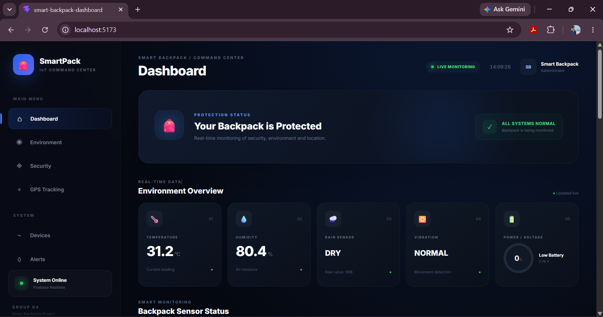
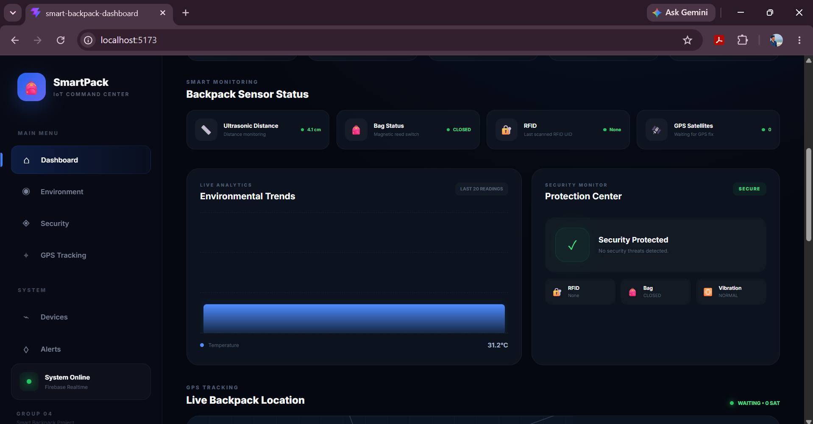
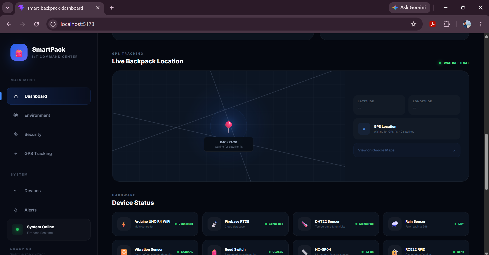
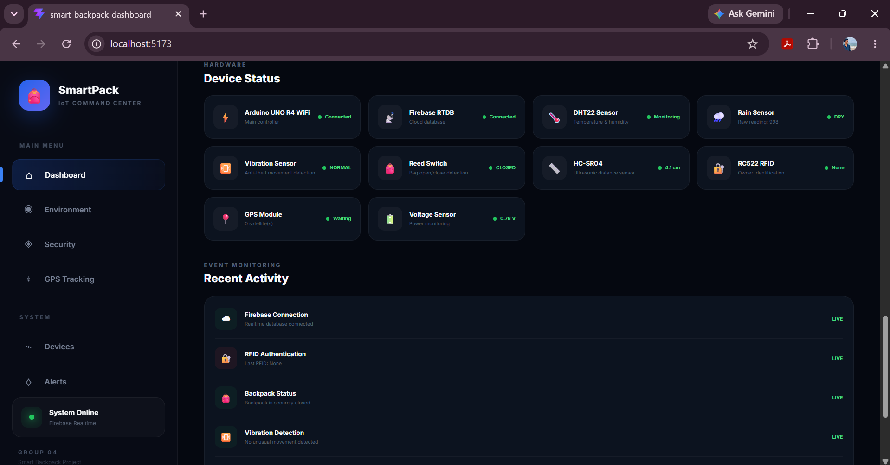
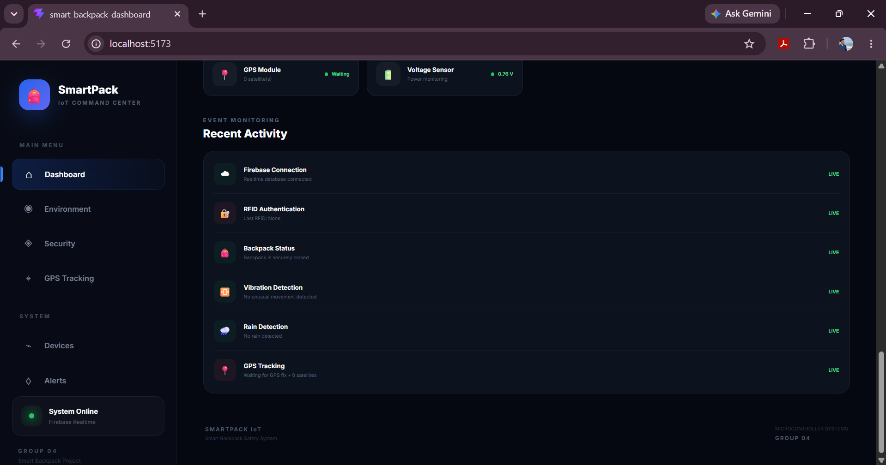
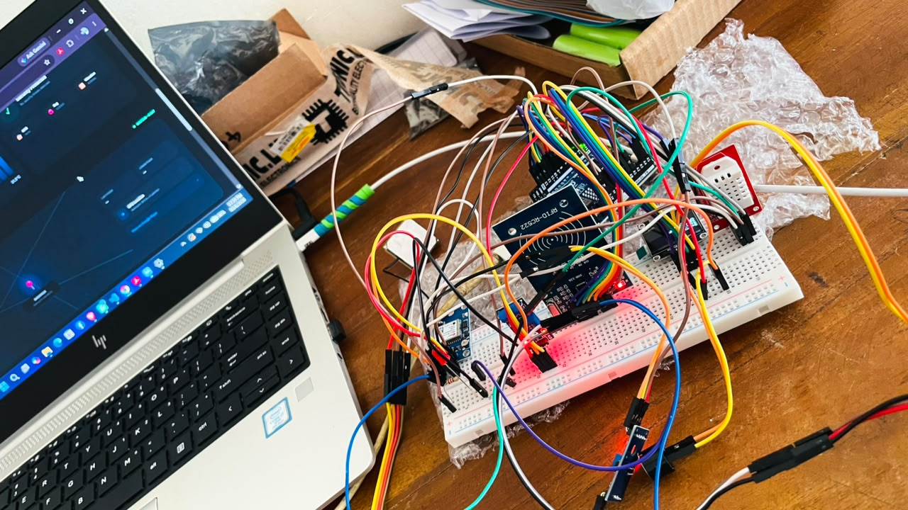
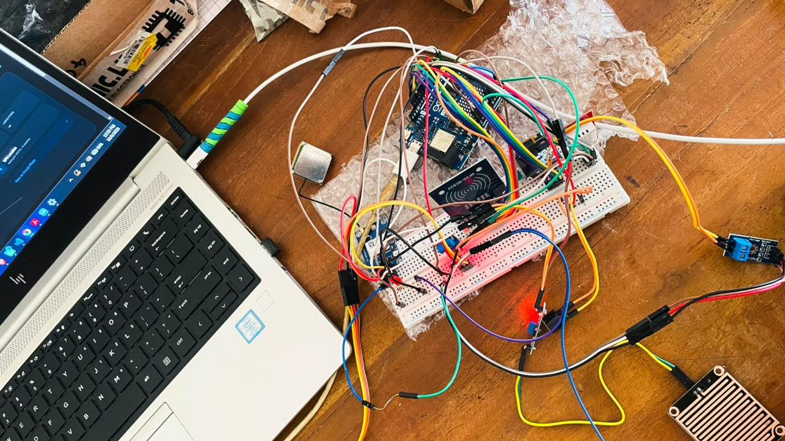
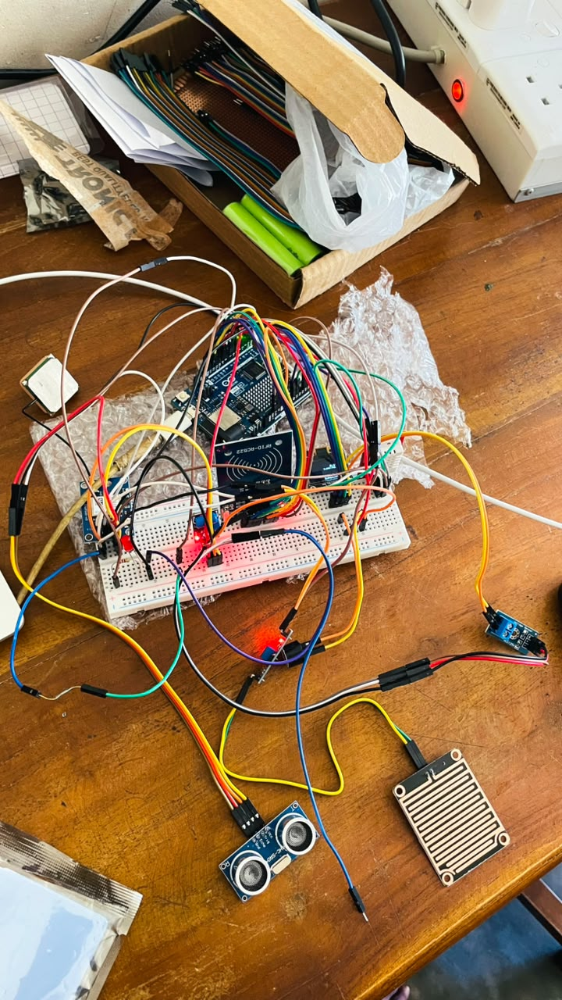
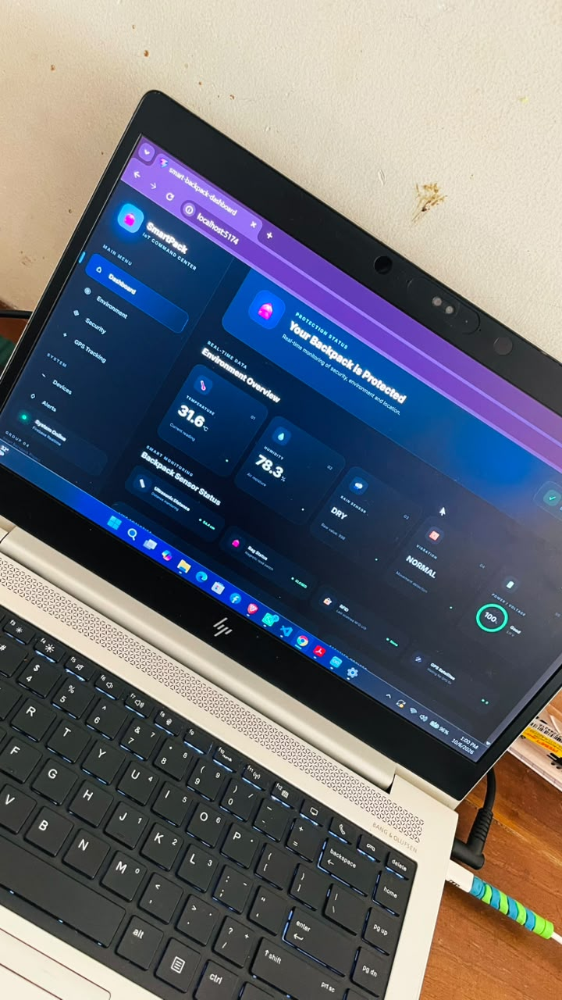

# Smart Backpack Safety, Anti-Theft & Location Tracking System

**Group 04 · Microcontroller Systems · Faculty of Technology · South Eastern University of Sri Lanka**

A university IoT prototype exploring backpack safety through sensor monitoring, RFID identification, and GPS location data.



## Repository scope

This repository contains the supplied Arduino integration-test sketch, dashboard screenshots, and breadboard prototype photographs. The React dashboard source and Firebase-upload sketch are **not included**. Dashboard screenshots document a separate project stage; the included sketch does not send data to Firebase.

## Included sketch

`arduino/fullcode/fullcode.ino` reads temperature, humidity, rain, vibration, bag state, voltage, ultrasonic distance, and GPS serial data. It prints readings to Serial Monitor, displays selected readings on an OLED, and attempts RFID scanning. A successful RFID scan triggers a short LED/buzzer confirmation. RFID UID reading does not by itself verify an authorized owner.

## Hardware

- Arduino UNO R4 WiFi
- DHT22 temperature/humidity sensor
- SSD1306 128×64 I2C OLED
- RC522 RFID reader and cards/tags
- GPS module communicating over Serial1
- SW-420 vibration sensor
- Rain sensor
- Magnetic reed switch and magnet
- HC-SR04 ultrasonic sensor
- Voltage sensor module
- Buzzer and LED with 220Ω resistor
- Breadboard and jumper wires

## Signal pin mapping from the supplied sketch

| Component | Arduino signal pin |
|---|---|
| SW-420 digital output | D2 |
| Reed switch | D3 (`INPUT_PULLUP`) |
| HC-SR04 TRIG | D4 |
| HC-SR04 ECHO | D5 |
| Buzzer control | D6 |
| DHT22 data | D7 |
| LED through resistor | D8 |
| RC522 RST | D9 |
| RC522 SS/SDA | D10 |
| RC522 MOSI / MISO / SCK | SPI signals (D11 / D12 / D13 on UNO R4) |
| Rain analog output | A0 |
| Voltage sensor output | A1 |
| OLED SDA / SCL | Board SDA / SCL; address `0x3C` |
| GPS TX → Arduino RX | D0 / Serial1 RX |
| GPS RX ← Arduino TX, if used | D1 / Serial1 TX |

This table records signal assignments, not a complete power-wiring guide. Confirm module supply and logic requirements before wiring. RC522 uses 3.3 V power; verify appropriate SPI logic-level handling for the 5 V UNO R4. Photos are project records, not a substitute for verified wiring.

## Open and run the Arduino sketch

1. Install Arduino IDE and its Arduino UNO R4 board package.
2. Select **Arduino UNO R4 WiFi** and the connected board port.
3. Install these libraries through Library Manager: **DHT sensor library** (and Adafruit Unified Sensor dependency), **Adafruit GFX Library**, **Adafruit SSD1306**, **MFRC522**, and **TinyGPSPlus**. Install any dependencies prompted by the IDE.
4. Open `arduino/fullcode/fullcode.ino`.
5. Verify wiring against your tested setup, then compile and upload.
6. Open Serial Monitor at **9600 baud**.

Expected startup text:

```text
==========================
SMART BACKPACK SYSTEM
Integration Test Started
==========================
```

Sensor reports follow. GPS displays coordinates only when its location is valid; otherwise it reports waiting for a fix. A detected RFID card prints its UID.

## Progress and known limitations

- Breadboard sensor integration is documented in the photographs.
- The separate dashboard screenshots display temperature, humidity, rain, vibration, bag state, distance, and voltage.
- The supplied screenshots show **GPS waiting with 0 satellites** and **RFID None**; they do not establish successful location tracking or owner authentication.
- The October 10 dashboard screenshot displays **0.76 V / 0%**. Voltage measurement and battery-percentage calibration need verification.
- The sketch uses a nominal 5 V ADC reference, 10-bit scaling, and a ×5 divider factor; confirm these against the actual module and measured voltage.
- A failed ultrasonic echo returns a displayed distance of zero, not a confirmed zero-centimetre measurement.
- The sketch uses blocking delays; continuous GPS reception and RFID responsiveness need further testing.
- DHT read failures and OLED initialization failures need more robust handling.
- Dashboard status indicators are interface output, not proof that every security function is validated.
- This is a prototype, not a completed theft-prevention product.

## Screenshots






## Breadboard prototype






## Next steps

- Restore and verify reliable RFID scanning and owner authorization.
- Obtain an outdoor GPS fix and validate coordinates.
- Calibrate voltage readings and battery estimation.
- Verify alerts with defined test cases.
- Continue Arduino–Firebase–React integration in the separate working project.

## Team

Group 04: Nimsara, Imesh, Thilan, Hashika, Eshan, Lavanya, and Umasha.

## License

No license has been selected. Agree on a license with the project team before granting reuse permissions.
